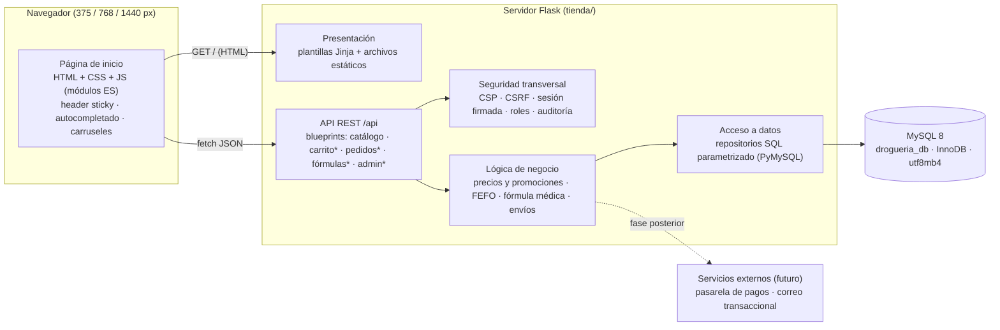
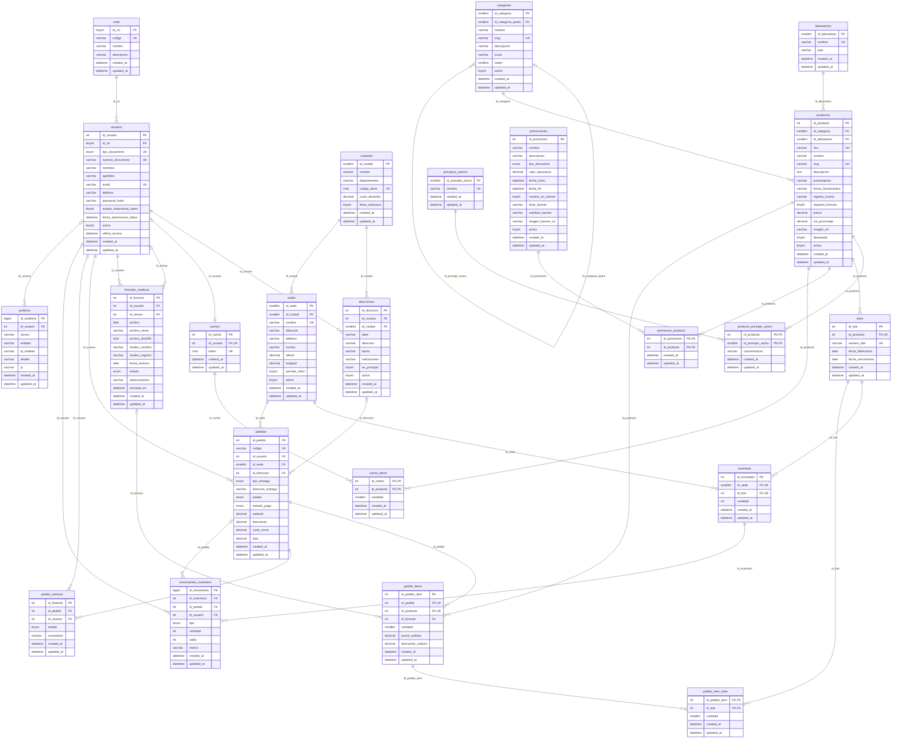

# Tienda en línea de la droguería — Documento de arquitectura

| | |
|---|---|
| **Proyecto** | E-commerce para una droguería en Colombia (catálogo, inventario por sede, pedidos y fórmula médica) |
| **Base de datos** | MySQL 8.x — base `drogueria_db` (toda la información del sistema vive en MySQL) |
| **Versión del documento** | 1.0 — 7 de noviembre de 2026 (Fase 2, pendiente de aprobación) |
| **Archivos relacionados** | [`database/schema.sql`](../database/schema.sql), [`database/seed.sql`](../database/seed.sql) |

> Ubicación: la tienda se construye dentro de la carpeta `DrogueriaGestion`, que ya contiene el sistema
> interno de gestión (Flask, base `drogueria_gestion`). Son proyectos independientes: la tienda usa su propia
> base `drogueria_db`, sus archivos SQL (`schema.sql`, `seed.sql`) y su propia carpeta de código (`tienda/`).
> No se modifica ningún archivo del sistema interno.

---

## 1. Referentes analizados

**Método.** El 7 de noviembre de 2026 recorrí cada sitio en un navegador real (el navegador integrado de
Claude, con ventana de 1440 × 900 px). No usé solo WebFetch porque el comportamiento del header al hacer scroll
únicamente se puede ver con la página renderizada. En cada sitio:
1. Revisé la página de inicio.
2. Medí con JavaScript la posición (`position`), la altura y la sombra del header, antes y después de bajar unos
   1000 px.
3. Busqué "losartan" (un medicamento que se vende con fórmula) para ver las tarjetas, los filtros y la marca de fórmula.
4. Abrí una ficha de producto.
5. Agregué un producto al carrito sin iniciar sesión.

No creé cuentas, no inicié sesión y no ingresé datos personales. Por eso el flujo de compra se describe solo
hasta donde el sitio lo mostró sin datos.

**No analizado:** Droguería Pasteur. Con los 5 sitios de abajo ya se cumple el rango pedido (4 a 6).

| Sitio | URL visitada | Patrón observado | Cómo lo aplicamos |
|---|---|---|---|
| Cruz Verde | https://www.cruzverde.com.co/ (búsqueda: `/search?query=losartan`, carrito: `/bolsa`) | Header `sticky` de 90 px. La barra promocional y la barra secundaria quedan fuera del header y se van con el scroll. Etiqueta de texto "Fórmula médica simple" en la tarjeta. Botón "Agregar" que se convierte en selector de cantidad. Carrito en 3 pasos (Carrito → Despacho/Retiro → Pago y confirmación) con barra de progreso hacia el envío gratis | Header `sticky` que oculta la barra promocional al bajar. Insignia de **texto** para la fórmula médica. Checkout en 3 pasos |
| Farmatodo | https://www.farmatodo.com.co/ (búsqueda: `/buscar?product=losartan`, ficha: `/producto/1000694-…`) | Header `sticky` de 3 filas (140 px) que no cambia al hacer scroll. *Skeletons* mientras carga. En la tarjeta, ícono de fórmula con `alt="Formula Medica"`. La ficha muestra Registro Invima, principio activo, concentración, forma farmacéutica y presentación, más la leyenda "ESTE PRODUCTO REQUIERE FÓRMULA MÉDICA PARA SU COMPRA." | Skeletons en los estados de carga. Ficha con los mismos datos sanitarios (están en el modelo de datos) |
| Drogas La Rebaja | https://www.larebajavirtual.com/ (búsqueda: `/losartan?_q=losartan&map=ft`) | El contenedor del header pasa a `position: fixed` (143 px) al bajar y mantiene la barra superior. Insignia "RX" que es **solo imagen** (no hay texto en el DOM). Para comprar exige iniciar sesión (modal). Un banner que carga tarde desplazó el contenido (salto de diseño) | Reservar el espacio de banners e imágenes (`aspect-ratio`) para tener CLS < 0,1. No exigir sesión para armar el carrito. La insignia de fórmula siempre lleva texto legible |
| Droguerías Colsubsidio | https://www.drogueriascolsubsidio.com/ (búsqueda: `/losartan?_q=losartan&map=ft`) | Modal promocional al entrar. Header `sticky` de 160 px sin cambios al hacer scroll. Chip de texto "Requiere fórmula médica". Precio por unidad ("Tableta a $860,00"). Filtro por **principio activo**. Antes de agregar al carrito pide correo y método de entrega | Filtro por principio activo (tabla `principios_activos`). El método de entrega se elige en el checkout, no al agregar al carrito |
| Locatel | https://www.locatelcolombia.com/ (búsqueda: `/losartan?_q=losartan&map=ft`, ficha: `/7702057710163-…/p`) | El contenedor del header es `relative` debajo de una barra promocional de 40 px y pasa a `fixed` al bajar: la barra promocional desaparece. Buscador con "Términos más buscados". No hay insignia de fórmula en la tarjeta; solo aparece en el texto de la ficha ("Venta bajo receta médica"). Pide la ubicación antes de agregar al carrito | Sugerencias en el buscador (autocompletado). La fórmula se marca en la tarjeta y en la ficha, no solo en la descripción |

### 1.1 Detalle por sitio

**Cruz Verde** — https://www.cruzverde.com.co/
- *Al entrar*: modal para elegir la localidad ("Podrás conocer el inventario online y tiempos de entrega").
- *Header*:
  - Arriba, una barra promocional delgada (tiempo de entrega promedio y "Consulta TyC").
  - Fila principal: logo, botón "Menú de Categorías", buscador, ubicación, "Bienvenid@ / Inicia sesión" y carrito
    con contador.
  - Debajo, una barra verde con la ubicación, el teléfono de domicilios, el club de lealtad, "Usuarios EPS" y
    "Los Habituales".
  - Bajo el banner, una fila de categorías con íconos circulares.
- *Scroll*: el elemento `<header>` tiene `position: sticky; top: 0` y mide 90 px tanto arriba como en
  `scrollY = 1000`, sin sombra. Las barras promocional y secundaria están fuera del header y se van con el scroll.
- *Tarjeta*: laboratorio en mayúsculas, nombre con la presentación, precio actual y "precio normal" tachado,
  íconos de "Despacho" y "Retiro", etiqueta "Fórmula médica simple", precio por unidad de medida (PUM) y botón
  "Agregar". Al pulsarlo aparece un selector de cantidad con "Máx. N unidades". Sin existencias muestra
  "No disponible".
- *Fórmula médica*: etiqueta de texto en la tarjeta. Al agregar al carrito no se pidió la fórmula.
- *Filtros*: Envío gratis (interruptor), Marca, Precio, Formato de presentación y "Los Habituales", con botón
  "Aplicar filtros", orden y cantidad de resultados por página.
- *Flujo de compra*: el carrito (`/bolsa`) muestra tres pasos: "Carrito de Compras", "Despacho / Retiro" y
  "Pago y Confirmación". Incluye una barra de progreso hacia el envío gratis, un resumen (total, ahorro y
  subtotal), un aviso de que el envío no está incluido, "Ir a Pagar", "Seguir comprando" y un carrusel de
  recomendados. No avancé más porque los pasos siguientes piden datos.

**Farmatodo** — https://www.farmatodo.com.co/
- *Header*:
  - Fila 1: logo, selector de país, buscador con desplegable de categorías, "Inicia sesión", ubicación y carrito.
  - Fila 2 (azul): "Más categorías" (menú hamburguesa), Mundo Ofertas, Mis Favoritos, Volver a comprar, Tiendas
    oficiales, Pastillero Virtual y Cupones.
  - Fila 3: categorías (Salud y medicamentos, Belleza, Cuidado del bebé…).
  - No vi una barra promocional separada.
- *Scroll*: `<header>` con `position: sticky`, de 140 px antes y después de bajar (`scrollY ≈ 1760`), sin sombra.
  Las tres filas se quedan.
- *Carga*: mientras llegan los datos, la página muestra bloques grises (*skeletons*).
- *Tarjeta*: imagen, favorito, botón circular "+", nombre, precio con descuento y precio anterior tachado, precio
  por unidad ("Unidades a $399.17"), estrellas con número de reseñas y tiempo de entrega ("35 mins").
- *Fórmula médica*:
  - En la tarjeta, un ícono con `alt="Formula Medica"` y el título "Por su seguridad no se automedique".
  - En la ficha, la leyenda "ESTE PRODUCTO REQUIERE FÓRMULA MÉDICA PARA SU COMPRA." y un bloque "Información" con
    Registro Invima, marca, principio activo, concentración, forma farmacéutica y presentación.
- *Filtros*: Progresivo y Ahorra, Prime, Categoría, Marca, Subcategoría y Precio (rango deslizable), con
  "Limpiar filtros".
- *Flujo de compra*:
  - En la ficha, "Agregar producto" se convierte en un selector −/+.
  - El ícono del carrito abre un minicarrito con el producto y el botón "Ir al carrito".
  - La página `/carrito` se quedó cargando sin sesión, así que **no pude ver los pasos siguientes**.
  - En el pie aparecen los medios de pago (tarjetas, datáfono y contra entrega).

**Drogas La Rebaja** — https://www.larebajavirtual.com/
- *Header*:
  - Arriba, una barra roja delgada ("¿Queremos saber quién eres?", WhatsApp, Blog).
  - Fila principal: menú hamburguesa, logo, buscador "¿Qué estás buscando?" y "Mi cuenta".
  - Una fila de campañas y categorías destacadas.
- *Scroll*: en la carga inicial no había elementos fijos. Al bajar, el contenedor del header (`vtex-sticky-layout`)
  pasa a `position: fixed` (clase `fix`), mide 143 px, no tiene sombra y conserva la barra superior.
- *Tarjeta*: insignia "Ahorra 20%", marca, nombre, "Antes $…" tachado, precio, "Presentación: caja x 30 tab" y
  botón "Comprar".
- *Fórmula médica*: insignia "RX" en la esquina de la imagen. Es una **imagen sin texto en el DOM**, así que un
  lector de pantalla no la anuncia. La categoría se llama "Medicamentos con formula medica".
- *Filtros*: Departamento, Categoría, Sub-categoría, Marca y Rango de precio, con conteo de resultados, vista en
  grilla o lista y orden por relevancia.
- *Flujo de compra*: "Comprar" abre el modal "Inicia sesión" (código por correo, Google, correo y contraseña, y
  casilla de aceptación de términos y tratamiento de datos). No inicié sesión.
- *Observación*: un banner que cargó tarde empujó la grilla hacia abajo (salto de diseño visible).

**Droguerías Colsubsidio** — https://www.drogueriascolsubsidio.com/
- *Al entrar*: modal promocional a pantalla completa (cerrable).
- *Header*:
  - Arriba, una barra promocional delgada con los teléfonos de venta por ciudad.
  - Fila principal: logo, botón "Menú", buscador, "Ubicación", "Mi perfil" y "Mi carrito" con contador.
  - Fila de categorías (Ofertas, Medicamentos, Belleza y Vitalidad, Higiene y Cuidado, Mamás y bebés) y un botón
    destacado de la app.
- *Scroll*: contenedor con `position: sticky`, de 160 px antes y después de bajar, sin sombra.
- *Tarjeta*: chip de texto "Requiere fórmula médica", presentación ("CAJA X 30 TAB"), nombre, precio, precio por
  unidad ("Tableta a $860,00") y botón "Agrega al carrito".
- *Filtros*: Departamento, Categoría ("Formulados"), Presentación, **Principio activo** y Rango de precios, con
  conteo de resultados y orden.
- *Flujo de compra*: al agregar al carrito se abre el modal "¿Cómo deseas recibir tu pedido?". Pide correo y
  elegir "Envío a domicilio" o "Retiro en tienda" antes de continuar. No ingresé datos.

**Locatel** — https://www.locatelcolombia.com/
- *Al entrar*: modal "Elige tu ubicación" (departamento, ciudad, dirección e información complementaria) y una
  invitación a recibir notificaciones.
- *Header*:
  - Arriba, una barra promocional en movimiento (cupón de primera compra).
  - Fila principal: logo, buscador (al enfocarlo muestra "Términos más buscados"), "Iniciar sesión / Cuenta" y
    "Mi carrito".
  - Fila de navegación: "Categorías" (menú hamburguesa), Marcas, Medicamentos, Vitaminas, Equipos médicos, Bono de
    regalo y Combos.
  - Una franja de envío gratis.
- *Scroll*: arriba, el contenedor del header es `relative` y está en `y = 40`, debajo de la barra promocional. Al
  bajar pasa a `position: fixed` en `y = 0` y la barra promocional se va con el scroll. Mide 145 px en ambos
  estados y no tiene sombra.
- *Tarjeta*: imagen, nombre, precio y "AGREGAR AL CARRITO". No tiene marca de fórmula.
- *Fórmula médica*: solo en la descripción de la ficha ("Venta bajo receta médica", "debe ser recetado bajo
  prescripción médica") y en el menú ("Medicamentos con Prescripción" y "Medicamentos sin Receta").
- *Filtros*: Departamento, Categoría, Sub-Categoría, Marca, Género y Presentación, con orden y un mensaje al final
  ("Has visto todos los 16 productos").
- *Flujo de compra*: la ficha tiene selector de cantidad, "Agregar al carrito", sellos (cambios y devoluciones,
  retiro en tiendas, compra segura, envíos gratis) y medios de pago. Al agregar pide la ubicación con el mismo
  modal antes de continuar.

### 1.2 Conclusiones de diseño

1. **Header en tres niveles.** Los cinco sitios usan barra promocional, fila principal (logo, buscador, cuenta y
   carrito) y menú de categorías. Adoptamos esa misma estructura.
2. **Header que acompaña el scroll.**
   - Los cinco mantienen visible el header al bajar: tres con `sticky` y dos cambiando a `fixed` con JavaScript.
   - Dos (Cruz Verde y Locatel) dejan que la barra promocional se vaya.
   - Ninguno lo compacta ni le agrega sombra.
   - Usaremos `position: sticky; top: 0`, que no necesita JavaScript para fijarse. Al bajar, el header se compacta
     y gana una sombra con una transición de 200 ms, y la barra promocional se oculta. Así se recupera espacio
     vertical, algo importante en móvil.
   - La altura reservada no cambia, para evitar saltos de diseño.
3. **Fórmula médica con texto visible.**
   - Las marcas con texto ("Requiere fórmula médica", "Fórmula médica simple") son claras.
   - Las que son solo ícono o imagen (Farmatodo, La Rebaja) o solo texto de la ficha (Locatel) son menos
     accesibles o fáciles de pasar por alto.
   - Nuestra insignia dirá "Requiere fórmula médica" en texto, con un ícono decorativo (`aria-hidden`).
4. **Ficha con datos sanitarios.** Registro INVIMA, principio activo, concentración, forma farmacéutica,
   presentación y laboratorio. Todo esto queda en el modelo de datos.
5. **No interrumpir con modales al entrar ni al agregar al carrito.**
   - Cuatro de los cinco abren un modal al entrar.
   - Tres exigen ubicación, correo o sesión antes de agregar.
   - Pediremos la ubicación y el método de entrega en el paso 2 del checkout. El carrito funciona sin sesión
     (tabla `carritos` con token).
6. **Estados de carga con *skeletons* y espacio reservado.** Los *skeletons* vienen de Farmatodo; el espacio
   reservado para el banner y las imágenes evita el salto que se vio en La Rebaja.
7. **Filtros útiles para una droguería**: categoría, laboratorio, **principio activo** (Colsubsidio), rango de
   precio, "requiere fórmula" y disponibilidad.
8. **Checkout en 3 pasos**: carrito → entrega (domicilio o retiro en sede) → pago y confirmación, como en
   Cruz Verde.
9. **Agregar al carrito con respuesta visible.** El botón se convierte en selector de cantidad y el contador del
   header se actualiza.
10. **Precio por unidad de medida (PUM).** Se vio en Cruz Verde, Farmatodo y Colsubsidio. Requiere guardar el
    contenido neto del empaque; queda como requerimiento *Could* (RF-32) y fuera de este esquema.

---

## 2. Stack recomendado

| Criterio | **A. Python 3.13 + Flask 3.1 + PyMySQL** | **B. Node.js 22 LTS + Express 5 + mysql2** |
|---|---|---|
| Rendimiento | Suficiente para el volumen de una droguería. Las consultas con índice tardan milisegundos y la latencia la marca MySQL, no el framework. Escala con varios procesos de un servidor WSGI | Muy bueno con mucha concurrencia de E/S gracias al *event loop*. `mysql2` soporta sentencias preparadas y *pool* |
| Curva de aprendizaje | **Baja para este equipo**: el sistema interno (`DrogueriaGestion`) ya usa Flask + PyMySQL. Sintaxis simple y síncrona | Media: exige dominar `async/await`, *promises* y el manejo de errores asíncronos |
| Hosting | VPS o PaaS con Gunicorn (Linux) o Waitress (Windows). Muchos *hostings* compartidos con cPanel aceptan apps Python | VPS o PaaS. Se ejecuta directamente con `node`. cPanel también ofrece apps Node |
| Ecosistema | Flask es mínimo y extensible. PyMySQL es Python puro. `cryptography` aporta Argon2id y la autenticación `caching_sha2_password` de MySQL 8 | npm es enorme, pero obliga a auditar muchas dependencias transitivas |
| MySQL 8 | PyMySQL 1.2 (consultas parametrizadas `%s`) | mysql2 3.x (placeholders `?`) |

**Elección: A (Python + Flask + PyMySQL).** Cumple las metas de rendimiento (API < 300 ms en p95) con pocas
dependencias. El equipo ya lo domina gracias al sistema interno, y reutiliza los mismos patrones: una conexión por
petición, consultas parametrizadas y capas separadas. `cryptography`, que PyMySQL ya necesita para autenticarse en
MySQL 8, cubre también el hash Argon2id de contraseñas, así que no hace falta una librería más. El frontend queda
en HTML, CSS y JavaScript sin frameworks, lo que ayuda a cumplir LCP < 2,5 s.

### 2.1 Dependencias exactas

Entorno:

| Componente | Versión | Uso |
|---|---|---|
| Python | 3.13.2 (instalado en este equipo) | Intérprete |
| MySQL Server | 8.x (objetivo). Los scripts también se validaron en el servidor 26.7.0 que hay en este equipo | Base de datos |

`tienda/requirements.txt` (versiones fijas):

| Paquete | Versión | Para qué |
|---|---|---|
| Flask | 3.1.3 | Servidor web, rutas, plantillas y API JSON |
| PyMySQL | 1.2.3 | Conexión a MySQL y consultas parametrizadas |
| cryptography | 50.0.2 | Argon2id para contraseñas y autenticación `caching_sha2_password` de MySQL 8 |
| python-dotenv | 1.2.4 | Leer credenciales desde `.env` |

Dependencias que pip instala automáticamente con las anteriores:

| Paquete | Versión |
|---|---|
| Werkzeug | 3.1.9 |
| Jinja2 | 3.1.6 |
| itsdangerous | 2.2.0 |
| click | 8.5.1 |
| blinker | 1.9.0 |
| MarkupSafe | 3.0.4 |
| cffi | 2.1.1 |
| pycparser | 3.12 |

Frontend: **sin dependencias npm**. Usa la fuente **Atkinson Hyperlegible** desde Google Fonts (pesos 400 y 700),
diseñada para máxima legibilidad. El prototipo usa el servidor de desarrollo de Flask. Para producción habrá que
aprobar un servidor WSGI (Gunicorn o Waitress) en una fase posterior.

---

## 3. Arquitectura del sistema

### 3.1 Capas

| Capa | Responsabilidad | Implementación |
|---|---|---|
| Presentación | HTML semántico, estilos *mobile-first*, header *sticky*, componentes accesibles, estados de carga, vacío y error | `templates/` (Jinja) y `static/` (CSS con variables y JS en módulos ES) |
| API | Endpoints REST JSON bajo `/api`. Valida la entrada, controla el acceso por rol y traduce errores a códigos HTTP | *Blueprints* de Flask (`app/api/`) |
| Lógica de negocio | Reglas: precio con la mejor promoción vigente, exigencia de fórmula aprobada, FEFO, cálculo de envío y totales, estados del pedido | `app/servicios/` (funciones sin acceso directo a HTTP) |
| Acceso a datos | SQL **siempre parametrizado**, una conexión por petición y transacciones para las escrituras de varias sentencias | `app/repositorios/` y `app/db.py` (PyMySQL) |
| Datos | Integridad con PK, FK, CHECK y UNIQUE; FULLTEXT para la búsqueda; InnoDB transaccional | MySQL 8, base `drogueria_db` |

La seguridad atraviesa todas las capas: cabeceras CSP, protección CSRF en los métodos que modifican datos, sesión
firmada con `itsdangerous`, control de acceso por rol en el servidor y registro en `auditoria` de las acciones del
personal.

### 3.2 Diagrama de componentes


\* Módulos documentados aquí, fuera del alcance del prototipo de la Fase 3.

### 3.3 Recorrido de una petición: búsqueda con autocompletado

1. **Navegador.** El usuario escribe "acet" en el buscador del header. El script espera 250 ms sin teclear
   (*debounce*), exige al menos 2 caracteres y cancela con `AbortController` la petición anterior que siga en
   curso.
2. **Petición.** Se envía `GET /api/productos/buscar?q=acet&limite=8`.
3. **API (blueprint `catalogo`).**
   - Recorta y valida `q` (2 a 60 caracteres) y `limite` (1 a 10). Si no son válidos, responde **422** con el
     detalle por campo.
   - Al ser una petición GET, no necesita token CSRF.
4. **Servicio `buscar_productos`.**
   - Elimina los operadores especiales de FULLTEXT (`+ - < > ( ) ~ * " @`) y arma el término booleano `acet*`.
   - Si el texto tiene menos de 3 caracteres (el mínimo de MySQL para FULLTEXT), usa solo el prefijo `LIKE`.
5. **Repositorio.** Ejecuta una sola consulta con parámetros `%s`:
   - `MATCH(nombre, descripcion) AGAINST (%s IN BOOLEAN MODE)`, o `nombre LIKE %s` como prefijo, o una
     coincidencia en `principios_activos.nombre`.
   - Un `LEFT JOIN` a la mejor promoción vigente para calcular el precio de oferta.
   - Filtro `activo = 1`, orden por relevancia y `LIMIT %s`.
6. **MySQL.** Resuelve la búsqueda con el índice `ft_productos_nombre_descripcion`. El `EXPLAIN` de la validación
   lo confirma: *"Full-text index search on productos using ft_productos_nombre_descripcion"*. Los prefijos usan
   `ix_productos_nombre`.
7. **Respuesta.** **200** con JSON
   `[{id, nombre, presentacion, precio, precio_oferta, requiere_formula, slug}]` y `Cache-Control: max-age=60`.
   Los errores de MySQL se registran en el log sin datos personales y se responden como **503** genérico.
8. **Navegador.** Pinta la lista (`role="listbox"`, `aria-activedescendant`) escapando todo el texto. Las flechas
   mueven la selección, Enter abre la ficha y Escape cierra. Sin resultados muestra "Sin resultados para «acet»";
   si la API falla, muestra un mensaje de error con opción de reintentar.

### 3.4 Estructura de carpetas propuesta

```
DrogueriaGestion/                  carpeta actual (también contiene el sistema interno, que no se toca)
├── docs/
│   └── ARQUITECTURA.md            este documento
├── database/
│   ├── schema.sql                 esquema de drogueria_db (tienda)
│   ├── seed.sql                   datos ficticios de prueba (tienda)
│   └── 01_…, 02_…, 03_…, init_db.py   ← pertenecen al sistema interno
└── tienda/                        e-commerce (Fase 3)
    ├── run.py                     punto de entrada del servidor de desarrollo
    ├── requirements.txt           dependencias fijas de la sección 2.1
    ├── .env.example               nombres de variables, sin valores reales (.env queda fuera de git)
    ├── README.md                  pasos para crear la base, cargar datos y arrancar
    └── app/
        ├── __init__.py            create_app(): configuración, blueprints, errores, cabeceras de seguridad
        ├── config.py              lectura de .env
        ├── db.py                  conexión PyMySQL por petición y helpers de consulta
        ├── api/catalogo.py        GET /api/categorias · /api/productos/destacados · /api/productos/buscar
        ├── servicios/catalogo.py  reglas de precio con promoción y armado de la búsqueda
        ├── repositorios/catalogo.py  consultas SQL parametrizadas
        ├── templates/index.html   página de inicio
        └── static/
            ├── css/estilos.css    variables de color, tipografía, header sticky, responsive
            ├── js/api.js          cliente fetch con manejo de errores
            ├── js/inicio.js       header, autocompletado, banner, carruseles, estados
            └── img/logo.svg       logo genérico
```
Los módulos futuros (carrito, pedidos, fórmulas, administración) se agregan como nuevos archivos en `api/`,
`servicios/` y `repositorios/`, sin cambiar la estructura.

---

## 4. Requerimientos funcionales

Prioridad MoSCoW: **M** = *Must*, **S** = *Should*, **C** = *Could*. La columna "Prototipo" indica qué cubre la
Fase 3.

| ID | Módulo | Descripción | Actor | Prioridad | Criterio de aceptación verificable | Prototipo |
|---|---|---|---|---|---|---|
| RF-01 | Catálogo y categorías | Navegar el catálogo por categorías y subcategorías desde el menú y la grilla de inicio | Visitante | M | El menú y la grilla muestran las categorías activas de `categorias` ordenadas por `orden`. Al desactivar una en la BD, desaparece al recargar | Sí |
| RF-02 | Catálogo | Listar los productos de una categoría con filtros (laboratorio, principio activo, rango de precio, requiere fórmula, disponible) y orden (relevancia, precio, nombre) | Visitante | M | Cada filtro reduce el resultado al subconjunto que cumple la condición en la BD. El conteo coincide con un `COUNT(*)` equivalente | No |
| RF-03 | Búsqueda | Buscar por nombre, descripción o principio activo | Visitante | M | "losartan" devuelve los 2 productos con losartán del *seed*. "clorfeniramina" encuentra el "Antigripal día y noche", que la contiene como principio activo aunque no aparezca en su nombre ni en su descripción | Parcial |
| RF-04 | Búsqueda | Autocompletado mientras se escribe | Visitante | M | Con 2 o más caracteres y 250 ms de pausa aparece un máximo de 8 sugerencias leídas de MySQL. Se recorren con flechas y Enter. Con menos de 2 caracteres no se envía la petición | Sí |
| RF-05 | Ficha de producto | Ver nombre, presentación, forma farmacéutica, principios activos con concentración, laboratorio, registro INVIMA, precio, precio de oferta e insignia de fórmula | Visitante | M | Todos los campos coinciden con la BD para el producto consultado. Si `requiere_formula = 1`, la insignia "Requiere fórmula médica" es visible | No |
| RF-06 | Inventario | Mostrar la disponibilidad del producto por sede, contando solo lotes vigentes | Visitante | M | Disponible = suma de `inventario.cantidad` de los lotes con `fecha_vencimiento >= CURDATE()`. El lote vencido del *seed* no suma | No |
| RF-07 | Carrito | Agregar, cambiar la cantidad (1 a 99) y quitar productos, con un contador en el header | Visitante | M | Tras cada acción, `carrito_items` refleja el cambio y el contador muestra la suma de cantidades. No se puede superar la existencia disponible | Contador visual |
| RF-08 | Carrito | Carrito persistente sin sesión (token en cookie) que se asocia al usuario al iniciar sesión | Visitante, cliente | S | Al recargar se conserva el carrito. Al iniciar sesión, `carritos.id_usuario` queda asignado y los ítems se fusionan sin duplicar | No |
| RF-09 | Checkout | Checkout en 3 pasos: carrito, entrega (domicilio o retiro en sede) y pago y confirmación | Cliente | M | No se puede confirmar sin dirección con cobertura (domicilio) o sin sede (retiro). El resumen muestra subtotal, descuento, envío y total; total = subtotal − descuento + envío | No |
| RF-10 | Pedidos | Registrar el pedido en una transacción: código consecutivo, precios congelados, descuento del inventario por FEFO y kárdex | Cliente | M | Tras confirmar existen `pedidos`, `pedido_items`, `pedido_item_lotes` y movimientos `VENTA`. Si una línea falla, no queda nada guardado (*rollback*) | No |
| RF-11 | Pedidos | Consultar el estado y la línea de tiempo del pedido | Cliente, farmacéutico | S | Cada cambio de estado agrega una fila en `pedido_historial` y se muestra en orden cronológico | No |
| RF-12 | Usuarios | Registro de cliente con autorización explícita de tratamiento de datos (Ley 1581 de 2012) | Visitante | M | No se crea la cuenta sin marcar la autorización. Se guardan `acepta_tratamiento_datos = 1` y la fecha | No |
| RF-13 | Usuarios | Inicio y cierre de sesión con roles cliente, farmacéutico y administrador | Todos | M | Con credenciales válidas se inicia sesión. Las rutas de farmacéutico o administrador responden 403 a un cliente. Hay bloqueo temporal tras 5 intentos fallidos | No |
| RF-14 | Usuarios | Recuperar la contraseña con un enlace firmado que vence | Cliente | S | El enlace caduca a los 30 minutos y solo sirve una vez | No |
| RF-15 | Direcciones | Administrar las direcciones de entrega (crear, editar, desactivar, marcar la principal) | Cliente | M | Solo hay una dirección principal por cliente. Las direcciones usadas en pedidos se desactivan y no se borran | No |
| RF-16 | Domicilios | Validar la cobertura y calcular el costo del domicilio por ciudad | Cliente | M | Una ciudad con `tiene_cobertura = 0` no permite domicilio. El costo de envío del pedido es igual a `ciudades.costo_domicilio` | No |
| RF-17 | Domicilios | Retiro en tienda: elegir una sede con existencias para todos los productos | Cliente | S | Solo se listan las sedes con `permite_retiro = 1` y existencias suficientes para cada línea | No |
| RF-18 | Fórmula médica | Cargar la fórmula médica (JPG, PNG o PDF de hasta 5 MB) para los productos que la requieren | Cliente | M | Se rechazan otros tipos o tamaños. Se guarda en `formulas_medicas` con su SHA-256 y estado `PENDIENTE` | No |
| RF-19 | Fórmula médica | El farmacéutico aprueba o rechaza la fórmula con observaciones | Farmacéutico | M | Al aprobar o rechazar se registran `id_revisor`, `revisada_en` y una fila en `auditoria` | No |
| RF-20 | Fórmula médica | Impedir el despacho de productos con fórmula sin una fórmula aprobada | Sistema | M | Un pedido con producto `requiere_formula = 1` queda en `PENDIENTE_FORMULA` hasta que su `pedido_items.id_formula` apunte a una fórmula `APROBADA` | No |
| RF-21 | Inventario | Gestionar el inventario por sede y lote (entradas y ajustes) con fecha de vencimiento | Administrador | M | Cada entrada o ajuste actualiza `inventario.cantidad` y registra el movimiento con el saldo resultante. No se aceptan lotes vencidos | No |
| RF-22 | Inventario | Vender solo lotes vigentes, despachar primero el que vence antes (FEFO) y alertar los próximos a vencer (≤ 90 días) | Sistema, administrador | M | Un lote vencido nunca se asigna a un pedido. El reporte de alertas lista los lotes con vencimiento ≤ 90 días | No |
| RF-23 | Inventario | Trazabilidad: kárdex por sede y lote, y lotes despachados en cada pedido | Administrador | S | Para cada inventario, el último `saldo` del kárdex es igual a la existencia actual (comprobado en la validación: 0 descuadres) | No |
| RF-24 | Sedes | Consultar las sedes con dirección, teléfono, horario y ubicación | Visitante | S | La página o sección de sedes muestra las sedes activas de la BD | Sí (sección beneficios) |
| RF-25 | Promociones | Promociones con vigencia por porcentaje o por valor, con el precio anterior tachado | Visitante | M | Solo se aplican promociones activas con NOW() dentro de la vigencia. Precio de oferta = mejor descuento. Se muestra el precio anterior tachado | Sí |
| RF-26 | Promociones | Banner principal rotativo alimentado por las promociones marcadas | Visitante | S | El banner muestra las promociones con `mostrar_en_banner = 1` vigentes. Si no hay ninguna, se muestra un banner institucional | Sí |
| RF-27 | Panel administrativo | CRUD de productos, categorías, laboratorios y principios activos | Administrador | M | Las operaciones validan campos (422 con errores por campo) y respetan las FK (409 si hay dependencias) | No |
| RF-28 | Panel administrativo | Gestionar usuarios del personal y sus roles | Administrador | S | Un administrador no puede quitarse su propio rol. Los cambios quedan en `auditoria` | No |
| RF-29 | Panel administrativo | Consultar la bitácora de auditoría con filtros | Administrador | S | Cada acción del personal genera una fila con usuario, acción, entidad y fecha; se filtra por fecha y usuario | No |
| RF-30 | Panel administrativo | Gestionar sedes, promociones e inventario desde el panel | Administrador | S | Los cambios se reflejan en la tienda al recargar (por ejemplo, una promoción nueva aparece en inicio dentro de su vigencia) | No |
| RF-31 | Catálogo | Carrusel de productos destacados y en promoción en inicio | Visitante | M | Muestra productos con `destacado = 1` o con promoción vigente, leídos de MySQL, con precio de oferta si aplica | Sí |
| RF-32 | Catálogo | Mostrar el precio por unidad de medida (PUM) | Visitante | C | Requiere agregar el contenido neto al producto (fuera de este esquema). Se verifica que PUM = precio / contenido | No |

**Total: 32 RF** (Must: 21 · Should: 10 · Could: 1).

---

## 5. Requerimientos no funcionales

| ID | Categoría | Requisito | Métrica medible | Cómo se verifica |
|---|---|---|---|---|
| RNF-01 | Rendimiento | La página de inicio carga rápido en móvil | LCP < 2,5 s en Lighthouse móvil; en producción, LCP < 2,5 s en el percentil 75 de los datos de campo | Lighthouse en modo móvil (4G simulado) sobre la página de inicio; el informe se guarda como evidencia |
| RNF-02 | Rendimiento | La API responde rápido bajo carga | p95 < 300 ms en `/api/categorias`, `/api/productos/destacados` y `/api/productos/buscar` con 50 usuarios concurrentes | Prueba de carga de 5 minutos y registro del tiempo de cada petición en el log del servidor |
| RNF-03 | Rendimiento / UX | Sin saltos de diseño e interacción fluida | CLS < 0,1 e INP < 200 ms | Lighthouse y panel Performance de DevTools haciendo scroll (el header compacto no debe mover el contenido) |
| RNF-04 | Rendimiento | La búsqueda usa índices | `EXPLAIN` muestra *Full-text index search* | `EXPLAIN` de la consulta de búsqueda (ya verificado en la sección 6.6) |
| RNF-05 | Seguridad | Contraseñas con hash Argon2id | 100 % de `usuarios.password_hash` en formato `$argon2id$v=19$m=65536,t=3,p=4$…` | Consulta SQL sobre la tabla (verificado: 3 de 3) y revisión de código |
| RNF-06 | Seguridad | Todas las consultas son parametrizadas | 0 consultas que concatenen datos del usuario | Revisión de código (búsqueda de f-strings y `%` en SQL) y prueba de inyección (`' OR 1=1 --`) sin efecto |
| RNF-07 | Seguridad | HTTPS obligatorio en producción | TLS 1.2 o superior, HSTS de 1 año y redirección 301 desde HTTP | SSL Labs con calificación A o superior; cabecera `Strict-Transport-Security` presente |
| RNF-08 | Seguridad | Mitigación del OWASP Top 10 | 0 alertas de riesgo alto o medio | OWASP ZAP *baseline scan*, más CSP sin `unsafe-inline` en scripts, CSRF en POST/PUT/DELETE, cookies `HttpOnly`, `Secure` y `SameSite`, y límite de 5 intentos de login cada 10 minutos |
| RNF-09 | Seguridad | Control de acceso en el servidor | 100 % de las rutas de personal responden 403 a un cliente | Pruebas automáticas por rol sobre cada ruta protegida |
| RNF-10 | Protección de datos | Cumplimiento de la Ley 1581 de 2012 (autorización, finalidad y derechos de consulta, actualización y supresión) | 100 % de los clientes con autorización y fecha. Política de tratamiento enlazada en el registro y en el pie. Las solicitudes se atienden en ≤ 15 días hábiles | Consulta `SELECT COUNT(*) FROM usuarios WHERE id_rol = 1 AND acepta_tratamiento_datos = 0` → 0, más revisión de la política y del procedimiento de reclamos |
| RNF-11 | Protección de datos | La fórmula médica es un dato sensible (salud, art. 5 de la Ley 1581) | Solo la ven su dueño y los farmacéuticos; cada consulta del personal queda auditada | Prueba de acceso con otro cliente → 403; fila en `auditoria` por cada consulta del personal |
| RNF-12 | Accesibilidad | Cumplimiento de WCAG 2.1 AA | Lighthouse Accesibilidad ≥ 95 y 0 errores críticos en axe | Lighthouse y axe DevTools, más una prueba manual: todo se usa con teclado, el foco es visible y los *landmarks* y etiquetas ARIA son correctos |
| RNF-13 | Legibilidad | Texto fácil de leer | Texto base ≥ 16 px, interlineado 1,5 y contraste ≥ 4,5:1 (≥ 3:1 en texto grande) | DevTools (estilos calculados) y verificador de contraste sobre la paleta |
| RNF-14 | Responsive | Diseño *mobile-first* sin desbordes | Sin scroll horizontal a 375, 768 y 1440 px. Menú hamburguesa por debajo de 768 px y buscador siempre visible | Prueba en esos tres anchos con capturas como evidencia |
| RNF-15 | Disponibilidad | Servicio disponible | ≥ 99,5 % mensual (≤ 3,6 h de caída al mes) | Monitor de disponibilidad externo con un *ping* a `/api/salud` cada minuto |
| RNF-16 | Escalabilidad | Crecer sin rediseñar | API sin estado (sesión firmada) que escala horizontalmente; p95 < 300 ms con 10 000 productos | Prueba de carga con datos sintéticos de 10 000 productos |
| RNF-17 | Mantenibilidad | Código organizado y probado | Capas separadas (API, servicios y repositorios), PEP 8 y cobertura ≥ 70 % en servicios y repositorios | Revisión de estructura, linter y reporte de cobertura de las pruebas (las herramientas de prueba se aprueban en su fase) |
| RNF-18 | Respaldos | Respaldos de MySQL | Respaldo diario con `mysqldump --single-transaction --routines`, retención de 30 días, binlog para restaurar a un punto en el tiempo, RPO ≤ 24 h y RTO ≤ 4 h | Restauración de prueba mensual en un servidor aparte, con registro del tiempo y de los conteos de filas |
| RNF-19 | Integridad | La base protege la consistencia | 100 % de las reglas críticas con PK, FK, CHECK o UNIQUE; escrituras compuestas en transacciones | Pruebas de violación: precio negativo, cantidad 0 y total inconsistente son rechazados (verificado en la sección 6.6) |
| RNF-20 | Compatibilidad | Navegadores soportados | Las dos últimas versiones de Chrome, Edge, Firefox y Safari (también en móvil) | Prueba manual de la página de inicio en cada navegador |
| RNF-21 | Observabilidad | Registros útiles y seguros | Todo error 5xx se registra con fecha, ruta y tiempo; los logs no contienen contraseñas, documentos ni fórmulas | Revisión del log tras forzar un error y búsqueda de datos sensibles en él |
| RNF-22 | Localización | Idioma y formato colombianos | Textos en español; precios en COP sin decimales con separador de miles "." (por ejemplo, $12.900); fechas dd/mm/aaaa | Revisión visual de la interfaz y pruebas del formateador |
| RNF-23 | Normativa sanitaria | Venta responsable de medicamentos | Registro INVIMA visible en la ficha. Los productos con fórmula no se despachan sin fórmula aprobada | Pruebas de RF-05 y RF-20 |

**Total: 23 RNF.**

---

## 6. Modelo de datos

**Resumen:** 23 tablas InnoDB con `utf8mb4_unicode_ci` y 33 llaves foráneas, todas con
`ON DELETE` y `ON UPDATE` explícitos y un índice propio. Hay 5 tablas puente para relaciones N:M. Todo el dinero se
guarda en `DECIMAL(12,2)`, todas las tablas tienen `created_at` y `updated_at`, y hay un índice FULLTEXT en
`productos(nombre, descripcion)`.

> Las secciones 6.1, 6.2 y 6.4 se generaron leyendo `information_schema` de la base creada con `schema.sql`.
> Coinciden exactamente con las tablas y las FK del script.

### 6.1 Diagrama entidad-relación

Notación: `||` = exactamente uno, `|o` = cero o uno (FK opcional), `o{` = cero o muchos, `o|` = cero o uno del
lado hijo (1:1).



### 6.2 Relaciones entre tablas

| # | Tabla origen (padre) | Tabla destino (hija) | Cardinalidad | FK (columna) | ON DELETE / ON UPDATE | Justificación |
|---|---|---|---|---|---|---|
| 1 | `roles` | `usuarios` | 1:N | `fk_usuarios_rol` (`usuarios.id_rol` → `roles.id_rol`) | RESTRICT / CASCADE | Cada usuario tiene un rol; no se borra un rol en uso. |
| 2 | `ciudades` | `direcciones` | 1:N | `fk_direcciones_ciudad` (`direcciones.id_ciudad` → `ciudades.id_ciudad`) | RESTRICT / CASCADE | La ciudad define cobertura y tarifa; no se borra una ciudad con direcciones. |
| 3 | `usuarios` | `direcciones` | 1:N | `fk_direcciones_usuario` (`direcciones.id_usuario` → `usuarios.id_usuario`) | CASCADE / CASCADE | Las direcciones son del cliente; si se elimina la cuenta se eliminan sus direcciones. |
| 4 | `ciudades` | `sedes` | 1:N | `fk_sedes_ciudad` (`sedes.id_ciudad` → `ciudades.id_ciudad`) | RESTRICT / CASCADE | Cada sede está en una ciudad con cobertura. |
| 5 | `categorias` | `categorias` | 1:N (opcional) | `fk_categorias_padre` (`categorias.id_categoria_padre` → `categorias.id_categoria`) | RESTRICT / CASCADE | Árbol de categorías (subcategorías); no se borra una categoría con hijas. |
| 6 | `categorias` | `productos` | 1:N | `fk_productos_categoria` (`productos.id_categoria` → `categorias.id_categoria`) | RESTRICT / CASCADE | Cada producto pertenece a una categoría del menú; no se borra una categoría con productos. |
| 7 | `laboratorios` | `productos` | 1:N | `fk_productos_laboratorio` (`productos.id_laboratorio` → `laboratorios.id_laboratorio`) | RESTRICT / CASCADE | Cada producto tiene un laboratorio titular; se conserva mientras haya productos. |
| 8 | `principios_activos` | `producto_principio_activo` | 1:N | `fk_ppa_principio_activo` (`producto_principio_activo.id_principio_activo` → `principios_activos.id_principio_activo`) | RESTRICT / CASCADE | Lado principio activo; no se borra un principio que usen productos. |
| 9 | `productos` | `producto_principio_activo` | 1:N | `fk_ppa_producto` (`producto_principio_activo.id_producto` → `productos.id_producto`) | CASCADE / CASCADE | Lado producto de la composición; si se borra el producto se borra su composición. |
| 10 | `productos` | `lotes` | 1:N | `fk_lotes_producto` (`lotes.id_producto` → `productos.id_producto`) | RESTRICT / CASCADE | Cada lote es de un producto; un producto con lotes no se borra (trazabilidad). |
| 11 | `lotes` | `inventario` | 1:N | `fk_inventario_lote` (`inventario.id_lote` → `lotes.id_lote`) | RESTRICT / CASCADE | Existencias por lote; un lote con existencias no se borra. |
| 12 | `sedes` | `inventario` | 1:N | `fk_inventario_sede` (`inventario.id_sede` → `sedes.id_sede`) | RESTRICT / CASCADE | Existencias por sede; una sede con inventario no se borra (se desactiva). |
| 13 | `productos` | `promocion_producto` | 1:N | `fk_pp_producto` (`promocion_producto.id_producto` → `productos.id_producto`) | CASCADE / CASCADE | Si se elimina un producto sale de las promociones. |
| 14 | `promociones` | `promocion_producto` | 1:N | `fk_pp_promocion` (`promocion_producto.id_promocion` → `promociones.id_promocion`) | CASCADE / CASCADE | Si se elimina la promoción se eliminan sus asociaciones. |
| 15 | `usuarios` | `carritos` | 1:1 (opcional) | `fk_carritos_usuario` (`carritos.id_usuario` → `usuarios.id_usuario`) | CASCADE / CASCADE | Relación 1:1 opcional: un usuario tiene como máximo un carrito activo (UNIQUE). |
| 16 | `carritos` | `carrito_items` | 1:N | `fk_ci_carrito` (`carrito_items.id_carrito` → `carritos.id_carrito`) | CASCADE / CASCADE | Los ítems viven con su carrito. |
| 17 | `productos` | `carrito_items` | 1:N | `fk_ci_producto` (`carrito_items.id_producto` → `productos.id_producto`) | CASCADE / CASCADE | Un producto eliminado desaparece de los carritos (no hay obligación legal sobre un carrito). |
| 18 | `usuarios` | `formulas_medicas` | 1:N (opcional) | `fk_formulas_revisor` (`formulas_medicas.id_revisor` → `usuarios.id_usuario`) | SET NULL / CASCADE | Farmacéutico que valida; si su cuenta se elimina, la fórmula conserva el resultado. |
| 19 | `usuarios` | `formulas_medicas` | 1:N | `fk_formulas_usuario` (`formulas_medicas.id_usuario` → `usuarios.id_usuario`) | RESTRICT / CASCADE | La fórmula es del cliente que la carga; se conserva por trazabilidad sanitaria. |
| 20 | `direcciones` | `pedidos` | 1:N (opcional) | `fk_pedidos_direccion` (`pedidos.id_direccion` → `direcciones.id_direccion`) | SET NULL / CASCADE | Opcional (NULL en retiro); si se borra la dirección, el pedido conserva la copia en texto. |
| 21 | `sedes` | `pedidos` | 1:N | `fk_pedidos_sede` (`pedidos.id_sede` → `sedes.id_sede`) | RESTRICT / CASCADE | Sede que despacha o donde se retira el pedido. |
| 22 | `usuarios` | `pedidos` | 1:N | `fk_pedidos_usuario` (`pedidos.id_usuario` → `usuarios.id_usuario`) | RESTRICT / CASCADE | Todo pedido es de un cliente; no se borra un cliente con pedidos (soporte contable). |
| 23 | `formulas_medicas` | `pedido_items` | 1:N (opcional) | `fk_pi_formula` (`pedido_items.id_formula` → `formulas_medicas.id_formula`) | RESTRICT / CASCADE | Fórmula que respalda un ítem que la requiere; no se borra una fórmula usada en una venta. |
| 24 | `pedidos` | `pedido_items` | 1:N | `fk_pi_pedido` (`pedido_items.id_pedido` → `pedidos.id_pedido`) | CASCADE / CASCADE | Los ítems forman parte del pedido. |
| 25 | `productos` | `pedido_items` | 1:N | `fk_pi_producto` (`pedido_items.id_producto` → `productos.id_producto`) | RESTRICT / CASCADE | No se borra un producto que ya se vendió. |
| 26 | `lotes` | `pedido_item_lotes` | 1:N | `fk_pil_lote` (`pedido_item_lotes.id_lote` → `lotes.id_lote`) | RESTRICT / CASCADE | Lado lote; un lote despachado no se borra (retiros sanitarios). |
| 27 | `pedido_items` | `pedido_item_lotes` | 1:N | `fk_pil_pedido_item` (`pedido_item_lotes.id_pedido_item` → `pedido_items.id_pedido_item`) | CASCADE / CASCADE | Lado ítem del despacho por lotes. |
| 28 | `pedidos` | `pedido_historial` | 1:N | `fk_ph_pedido` (`pedido_historial.id_pedido` → `pedidos.id_pedido`) | CASCADE / CASCADE | El historial vive con su pedido. |
| 29 | `usuarios` | `pedido_historial` | 1:N (opcional) | `fk_ph_usuario` (`pedido_historial.id_usuario` → `usuarios.id_usuario`) | SET NULL / CASCADE | Quién cambió el estado; NULL si la cuenta se elimina o si fue el sistema. |
| 30 | `inventario` | `movimientos_inventario` | 1:N | `fk_mi_inventario` (`movimientos_inventario.id_inventario` → `inventario.id_inventario`) | RESTRICT / CASCADE | Cada movimiento afecta un lote en una sede; no se borra inventario con kárdex. |
| 31 | `pedidos` | `movimientos_inventario` | 1:N (opcional) | `fk_mi_pedido` (`movimientos_inventario.id_pedido` → `pedidos.id_pedido`) | SET NULL / CASCADE | Movimiento originado por un pedido (venta/devolución); opcional. |
| 32 | `usuarios` | `movimientos_inventario` | 1:N (opcional) | `fk_mi_usuario` (`movimientos_inventario.id_usuario` → `usuarios.id_usuario`) | SET NULL / CASCADE | Usuario que registró el movimiento; opcional. |
| 33 | `usuarios` | `auditoria` | 1:N (opcional) | `fk_auditoria_usuario` (`auditoria.id_usuario` → `usuarios.id_usuario`) | SET NULL / CASCADE | Autor de la acción; la bitácora se conserva aunque la cuenta se elimine. |
| 34 | `productos` | `principios_activos` | **N:M** | tabla puente `producto_principio_activo`: `fk_ppa_principio_activo` + `fk_ppa_producto` | id_principio_activo: RESTRICT/CASCADE · id_producto: CASCADE/CASCADE | Un producto puede combinar varios principios activos (p. ej. losartán + hidroclorotiazida) y un principio activo está en muchos productos; la concentración depende de la pareja. |
| 35 | `sedes` | `lotes` | **N:M** | tabla puente `inventario`: `fk_inventario_lote` + `fk_inventario_sede` | id_lote: RESTRICT/CASCADE · id_sede: RESTRICT/CASCADE | Un lote puede repartirse en varias sedes y cada sede guarda muchos lotes; la existencia (cantidad) pertenece a la pareja sede-lote. |
| 36 | `promociones` | `productos` | **N:M** | tabla puente `promocion_producto`: `fk_pp_producto` + `fk_pp_promocion` | id_producto: CASCADE/CASCADE · id_promocion: CASCADE/CASCADE | Una promoción aplica a varios productos y un producto puede estar en varias campañas a lo largo del tiempo. |
| 37 | `carritos` | `productos` | **N:M** | tabla puente `carrito_items`: `fk_ci_carrito` + `fk_ci_producto` | id_carrito: CASCADE/CASCADE · id_producto: CASCADE/CASCADE | Un carrito tiene varios productos y un producto está en muchos carritos; la cantidad pertenece a la pareja. |
| 38 | `pedido_items` | `lotes` | **N:M** | tabla puente `pedido_item_lotes`: `fk_pil_lote` + `fk_pil_pedido_item` | id_lote: RESTRICT/CASCADE · id_pedido_item: CASCADE/CASCADE | Un ítem puede despacharse desde varios lotes (FEFO) y un lote alimenta muchos ítems; permite trazar retiros sanitarios por lote. |

### 6.3 Normalización y desnormalizaciones justificadas

El modelo está en **3FN**:
- Todos los atributos son atómicos (1FN).
- Las tablas con clave compuesta (las tablas puente) no tienen atributos que dependan solo de una parte de la
  clave; por ejemplo, `concentracion` depende del par producto-principio activo (2FN).
- No hay dependencias transitivas: laboratorio, ciudad, rol y principio activo están en tablas propias en vez de
  repetirse como texto (3FN).
- El stock **no** se guarda en `productos`: se calcula sumando `inventario` de los lotes vigentes.

Desnormalizaciones deliberadas, todas en documentos históricos que no deben cambiar:

| Columna | Por qué se guarda aunque podría calcularse u obtenerse con un JOIN |
|---|---|
| `pedidos.direccion_entrega` | Es una copia de la dirección al momento de comprar. Si el cliente edita o desactiva la dirección, el pedido debe conservar a dónde se entregó (soporte del despacho). También sostiene `ck_pedidos_entrega`, porque MySQL no permite CHECK sobre una columna FK con acción `SET NULL` |
| `pedido_items.precio_unitario`, `descuento_unitario` | Son el precio y el descuento vigentes **al comprar**. El precio de `productos` y las promociones cambian después |
| `pedidos.subtotal`, `descuento`, `costo_envio`, `total` | Son los valores cobrados, inmutables como en una factura. El CHECK `ck_pedidos_total` garantiza que total = subtotal − descuento + envío |
| `movimientos_inventario.saldo` | Es la existencia después de cada movimiento. Permite auditar el kárdex sin recalcular toda la historia. La validación comprobó 0 descuadres contra `inventario.cantidad` |

### 6.4 Diccionario de datos

#### `roles`

Roles del sistema: cliente, farmacéutico y administrador. Sirve a: RF-13, RF-28.

| Columna | Tipo | Nulo | Clave | Descripción |
|---|---|---|---|---|
| `id_rol` | `tinyint unsigned` | No | PK | Identificador autoincremental |
| `codigo` | `varchar(20)` | No | UK | CLIENTE, FARMACEUTICO, ADMINISTRADOR |
| `nombre` | `varchar(50)` | No |  | Nombre |
| `descripcion` | `varchar(255)` | Sí |  | Descripcion |
| `created_at` | `datetime` | No |  | Fecha de creación del registro |
| `updated_at` | `datetime` | No |  | Fecha de la última modificación |

#### `usuarios`

Personas registradas (clientes y personal). Sirve a: RF-12, RF-13, RF-14, RF-28.

| Columna | Tipo | Nulo | Clave | Descripción |
|---|---|---|---|---|
| `id_usuario` | `int unsigned` | No | PK | Identificador autoincremental |
| `id_rol` | `tinyint unsigned` | No | FK → roles | Id rol |
| `tipo_documento` | `enum('CC','CE','TI','PA','PPT')` | No | UK | Tipo documento |
| `numero_documento` | `varchar(20)` | No | UK | Numero documento |
| `nombres` | `varchar(80)` | No |  | Nombres |
| `apellidos` | `varchar(80)` | No |  | Apellidos |
| `email` | `varchar(120)` | No | UK | Email |
| `telefono` | `varchar(20)` | Sí |  | Telefono |
| `password_hash` | `varchar(255)` | No |  | Argon2id en formato PHC |
| `acepta_tratamiento_datos` | `tinyint` | No |  | Autorización Ley 1581 de 2012 |
| `fecha_autorizacion_datos` | `datetime` | Sí |  | Fecha autorizacion datos |
| `activo` | `tinyint` | No |  | 1 = visible/habilitado; 0 = desactivado (borrado lógico) |
| `ultimo_acceso` | `datetime` | Sí |  | Ultimo acceso |
| `created_at` | `datetime` | No |  | Fecha de creación del registro |
| `updated_at` | `datetime` | No |  | Fecha de la última modificación |

#### `ciudades`

Municipios con cobertura de domicilios y su tarifa. Sirve a: RF-15, RF-16.

| Columna | Tipo | Nulo | Clave | Descripción |
|---|---|---|---|---|
| `id_ciudad` | `smallint unsigned` | No | PK | Identificador autoincremental |
| `nombre` | `varchar(80)` | No |  | Nombre |
| `departamento` | `varchar(80)` | No |  | Departamento |
| `codigo_dane` | `char(5)` | No | UK | Código DANE del municipio |
| `costo_domicilio` | `decimal(12,2)` | No |  | Costo domicilio |
| `tiene_cobertura` | `tinyint` | No |  | Tiene cobertura |
| `created_at` | `datetime` | No |  | Fecha de creación del registro |
| `updated_at` | `datetime` | No |  | Fecha de la última modificación |

#### `direcciones`

Direcciones de entrega de cada cliente. Sirve a: RF-09, RF-15.

| Columna | Tipo | Nulo | Clave | Descripción |
|---|---|---|---|---|
| `id_direccion` | `int unsigned` | No | PK | Identificador autoincremental |
| `id_usuario` | `int unsigned` | No | FK → usuarios | Id usuario |
| `id_ciudad` | `smallint unsigned` | No | FK → ciudades | Id ciudad |
| `alias` | `varchar(40)` | No |  | Casa, Oficina... |
| `direccion` | `varchar(150)` | No |  | Direccion |
| `barrio` | `varchar(80)` | Sí |  | Barrio |
| `indicaciones` | `varchar(255)` | Sí |  | Torre, apartamento, referencias |
| `es_principal` | `tinyint` | No |  | Es principal |
| `activo` | `tinyint` | No |  | 1 = visible/habilitado; 0 = desactivado (borrado lógico) |
| `created_at` | `datetime` | No |  | Fecha de creación del registro |
| `updated_at` | `datetime` | No |  | Fecha de la última modificación |

#### `sedes`

Puntos de venta físicos (inventario propio, retiro en tienda). Sirve a: RF-17, RF-24, RF-30.

| Columna | Tipo | Nulo | Clave | Descripción |
|---|---|---|---|---|
| `id_sede` | `smallint unsigned` | No | PK | Identificador autoincremental |
| `id_ciudad` | `smallint unsigned` | No | FK → ciudades | Id ciudad |
| `nombre` | `varchar(80)` | No | UK | Nombre |
| `direccion` | `varchar(150)` | No |  | Direccion |
| `telefono` | `varchar(20)` | No |  | Telefono |
| `horario` | `varchar(120)` | No |  | Ej.: Lun-Sáb 7:00-21:00; Dom 8:00-14:00 |
| `latitud` | `decimal(9,6)` | Sí |  | Latitud |
| `longitud` | `decimal(9,6)` | Sí |  | Longitud |
| `permite_retiro` | `tinyint` | No |  | Recoger en tienda |
| `activo` | `tinyint` | No |  | 1 = visible/habilitado; 0 = desactivado (borrado lógico) |
| `created_at` | `datetime` | No |  | Fecha de creación del registro |
| `updated_at` | `datetime` | No |  | Fecha de la última modificación |

#### `categorias`

Árbol de categorías del catálogo (menú). Sirve a: RF-01, RF-02, RF-27.

| Columna | Tipo | Nulo | Clave | Descripción |
|---|---|---|---|---|
| `id_categoria` | `smallint unsigned` | No | PK | Identificador autoincremental |
| `id_categoria_padre` | `smallint unsigned` | Sí | FK → categorias | NULL = categoría principal |
| `nombre` | `varchar(80)` | No |  | Nombre |
| `slug` | `varchar(90)` | No | UK | Fragmento de URL |
| `descripcion` | `varchar(255)` | Sí |  | Descripcion |
| `icono` | `varchar(40)` | Sí |  | Nombre del ícono SVG del frontend |
| `orden` | `smallint unsigned` | No |  | Orden |
| `activo` | `tinyint` | No |  | 1 = visible/habilitado; 0 = desactivado (borrado lógico) |
| `created_at` | `datetime` | No |  | Fecha de creación del registro |
| `updated_at` | `datetime` | No |  | Fecha de la última modificación |

#### `laboratorios`

Laboratorios fabricantes o titulares del registro. Sirve a: RF-02, RF-05, RF-27.

| Columna | Tipo | Nulo | Clave | Descripción |
|---|---|---|---|---|
| `id_laboratorio` | `smallint unsigned` | No | PK | Identificador autoincremental |
| `nombre` | `varchar(100)` | No | UK | Nombre |
| `pais` | `varchar(60)` | No |  | Pais |
| `created_at` | `datetime` | No |  | Fecha de creación del registro |
| `updated_at` | `datetime` | No |  | Fecha de la última modificación |

#### `principios_activos`

Sustancias activas (un producto puede combinar varias). Sirve a: RF-03, RF-05, RF-27.

| Columna | Tipo | Nulo | Clave | Descripción |
|---|---|---|---|---|
| `id_principio_activo` | `smallint unsigned` | No | PK | Identificador autoincremental |
| `nombre` | `varchar(120)` | No | UK | Denominación común internacional (DCI) |
| `created_at` | `datetime` | No |  | Fecha de creación del registro |
| `updated_at` | `datetime` | No |  | Fecha de la última modificación |

#### `productos`

Catálogo de medicamentos y productos de cuidado. Sirve a: RF-01 a RF-05, RF-27, RF-31.

| Columna | Tipo | Nulo | Clave | Descripción |
|---|---|---|---|---|
| `id_producto` | `int unsigned` | No | PK | Identificador autoincremental |
| `id_categoria` | `smallint unsigned` | No | FK → categorias | Id categoria |
| `id_laboratorio` | `smallint unsigned` | No | FK → laboratorios | Id laboratorio |
| `sku` | `varchar(30)` | No | UK | Código interno o EAN |
| `nombre` | `varchar(150)` | No |  | Nombre |
| `slug` | `varchar(170)` | No | UK | Slug |
| `descripcion` | `text` | Sí |  | Descripcion |
| `presentacion` | `varchar(80)` | No |  | Ej.: Caja x 30 tabletas |
| `forma_farmaceutica` | `varchar(40)` | No |  | Tableta, jarabe, crema... |
| `registro_invima` | `varchar(40)` | Sí |  | Registro sanitario INVIMA |
| `requiere_formula` | `tinyint` | No |  | 1 = venta bajo fórmula médica |
| `precio` | `decimal(12,2)` | No |  | Precio de venta sin promoción, IVA incluido |
| `iva_porcentaje` | `decimal(5,2)` | No |  | Iva porcentaje |
| `imagen_url` | `varchar(255)` | Sí |  | Imagen url |
| `destacado` | `tinyint` | No |  | Aparece en el carrusel de inicio |
| `activo` | `tinyint` | No |  | 1 = visible/habilitado; 0 = desactivado (borrado lógico) |
| `created_at` | `datetime` | No |  | Fecha de creación del registro |
| `updated_at` | `datetime` | No |  | Fecha de la última modificación |

#### `producto_principio_activo`

Tabla puente N:M producto - principio activo, con su concentración. Sirve a: RF-03, RF-05.

| Columna | Tipo | Nulo | Clave | Descripción |
|---|---|---|---|---|
| `id_producto` | `int unsigned` | No | PK, FK → productos | Id producto |
| `id_principio_activo` | `smallint unsigned` | No | PK, FK → principios_activos | Id principio activo |
| `concentracion` | `varchar(40)` | No |  | Ej.: 500 mg, 12,5 mg/5 mL |
| `created_at` | `datetime` | No |  | Fecha de creación del registro |
| `updated_at` | `datetime` | No |  | Fecha de la última modificación |

#### `lotes`

Lotes de fabricante con su fecha de vencimiento. Sirve a: RF-21, RF-22, RF-23.

| Columna | Tipo | Nulo | Clave | Descripción |
|---|---|---|---|---|
| `id_lote` | `int unsigned` | No | PK | Identificador autoincremental |
| `id_producto` | `int unsigned` | No | FK → productos, UK | Id producto |
| `numero_lote` | `varchar(40)` | No | UK | Numero lote |
| `fecha_fabricacion` | `date` | Sí |  | Fecha fabricacion |
| `fecha_vencimiento` | `date` | No |  | Fecha vencimiento |
| `created_at` | `datetime` | No |  | Fecha de creación del registro |
| `updated_at` | `datetime` | No |  | Fecha de la última modificación |

#### `inventario`

Tabla puente N:M sede - lote con la existencia. Sirve a: RF-06, RF-17, RF-21, RF-30.

| Columna | Tipo | Nulo | Clave | Descripción |
|---|---|---|---|---|
| `id_inventario` | `int unsigned` | No | PK | Identificador autoincremental |
| `id_sede` | `smallint unsigned` | No | FK → sedes, UK | Id sede |
| `id_lote` | `int unsigned` | No | FK → lotes, UK | Id lote |
| `cantidad` | `int unsigned` | No |  | Existencia actual del lote en la sede |
| `created_at` | `datetime` | No |  | Fecha de creación del registro |
| `updated_at` | `datetime` | No |  | Fecha de la última modificación |

#### `promociones`

Campañas de descuento con vigencia. Sirve a: RF-25, RF-26, RF-30.

| Columna | Tipo | Nulo | Clave | Descripción |
|---|---|---|---|---|
| `id_promocion` | `int unsigned` | No | PK | Identificador autoincremental |
| `nombre` | `varchar(100)` | No |  | Nombre |
| `descripcion` | `varchar(255)` | Sí |  | Descripcion |
| `tipo_descuento` | `enum('PORCENTAJE','VALOR')` | No |  | Tipo descuento |
| `valor_descuento` | `decimal(12,2)` | No |  | % (1-90) o pesos por unidad |
| `fecha_inicio` | `datetime` | No |  | Fecha inicio |
| `fecha_fin` | `datetime` | No |  | Fecha fin |
| `mostrar_en_banner` | `tinyint` | No |  | Alimenta el banner rotativo de inicio |
| `titulo_banner` | `varchar(80)` | Sí |  | Titulo banner |
| `subtitulo_banner` | `varchar(150)` | Sí |  | Subtitulo banner |
| `imagen_banner_url` | `varchar(255)` | Sí |  | Imagen banner url |
| `activo` | `tinyint` | No |  | 1 = visible/habilitado; 0 = desactivado (borrado lógico) |
| `created_at` | `datetime` | No |  | Fecha de creación del registro |
| `updated_at` | `datetime` | No |  | Fecha de la última modificación |

#### `promocion_producto`

Tabla puente N:M promoción - producto. Sirve a: RF-25.

| Columna | Tipo | Nulo | Clave | Descripción |
|---|---|---|---|---|
| `id_promocion` | `int unsigned` | No | PK, FK → promociones | Id promocion |
| `id_producto` | `int unsigned` | No | PK, FK → productos | Id producto |
| `created_at` | `datetime` | No |  | Fecha de creación del registro |
| `updated_at` | `datetime` | No |  | Fecha de la última modificación |

#### `carritos`

Carrito activo (anónimo por token o asociado 1:1 a un usuario). Sirve a: RF-07, RF-08.

| Columna | Tipo | Nulo | Clave | Descripción |
|---|---|---|---|---|
| `id_carrito` | `int unsigned` | No | PK | Identificador autoincremental |
| `id_usuario` | `int unsigned` | Sí | FK → usuarios, UK | NULL mientras el visitante no inicia sesión |
| `token` | `char(36)` | No | UK | UUID guardado en una cookie |
| `created_at` | `datetime` | No |  | Fecha de creación del registro |
| `updated_at` | `datetime` | No |  | Fecha de la última modificación |

#### `carrito_items`

Tabla puente N:M carrito - producto con la cantidad. Sirve a: RF-07.

| Columna | Tipo | Nulo | Clave | Descripción |
|---|---|---|---|---|
| `id_carrito` | `int unsigned` | No | PK, FK → carritos | Id carrito |
| `id_producto` | `int unsigned` | No | PK, FK → productos | Id producto |
| `cantidad` | `smallint unsigned` | No |  | Cantidad |
| `created_at` | `datetime` | No |  | Fecha de creación del registro |
| `updated_at` | `datetime` | No |  | Fecha de la última modificación |

#### `formulas_medicas`

Fórmulas médicas cargadas por los clientes y su validación. Sirve a: RF-18, RF-19, RF-20.

| Columna | Tipo | Nulo | Clave | Descripción |
|---|---|---|---|---|
| `id_formula` | `int unsigned` | No | PK | Identificador autoincremental |
| `id_usuario` | `int unsigned` | No | FK → usuarios | Cliente que la carga |
| `id_revisor` | `int unsigned` | Sí | FK → usuarios | Farmacéutico que la valida |
| `archivo` | `mediumblob` | No |  | Imagen o PDF (máx. 5 MB, validado en la API) |
| `archivo_mime` | `varchar(50)` | No |  | Archivo mime |
| `archivo_sha256` | `char(64)` | No |  | Archivo sha256 |
| `medico_nombre` | `varchar(120)` | Sí |  | Medico nombre |
| `medico_registro` | `varchar(30)` | Sí |  | Registro profesional del prescriptor |
| `fecha_emision` | `date` | No |  | Fecha emision |
| `estado` | `enum('PENDIENTE','APROBADA','RECHAZADA')` | No |  | Estado |
| `observaciones` | `varchar(255)` | Sí |  | Observaciones |
| `revisada_en` | `datetime` | Sí |  | Revisada en |
| `created_at` | `datetime` | No |  | Fecha de creación del registro |
| `updated_at` | `datetime` | No |  | Fecha de la última modificación |

#### `pedidos`

Encabezado de los pedidos de la tienda en línea. Sirve a: RF-09, RF-10, RF-11.

| Columna | Tipo | Nulo | Clave | Descripción |
|---|---|---|---|---|
| `id_pedido` | `int unsigned` | No | PK | Identificador autoincremental |
| `codigo` | `varchar(20)` | No | UK | Ej.: PED-000123 |
| `id_usuario` | `int unsigned` | No | FK → usuarios | Id usuario |
| `id_sede` | `smallint unsigned` | No | FK → sedes | Sede que despacha o donde se retira |
| `id_direccion` | `int unsigned` | Sí | FK → direcciones | NULL si es retiro en tienda |
| `tipo_entrega` | `enum('DOMICILIO','RETIRO')` | No |  | Tipo entrega |
| `direccion_entrega` | `varchar(400)` | Sí |  | Copia de la dirección al momento de comprar |
| `estado` | `enum('PENDIENTE_FORMULA','CONFIRMADO','EN_PREPARACION','EN_CAMINO','LISTO_PARA_RETIRO','ENTREGADO','CANCELADO')` | No |  | Estado |
| `metodo_pago` | `enum('CONTRA_ENTREGA','TARJETA','PSE')` | No |  | Metodo pago |
| `subtotal` | `decimal(12,2)` | No |  | Subtotal |
| `descuento` | `decimal(12,2)` | No |  | Descuento |
| `costo_envio` | `decimal(12,2)` | No |  | Costo envio |
| `total` | `decimal(12,2)` | No |  | Total |
| `created_at` | `datetime` | No |  | Fecha de creación del registro |
| `updated_at` | `datetime` | No |  | Fecha de la última modificación |

#### `pedido_items`

Productos de cada pedido (precio congelado al comprar). Sirve a: RF-10, RF-20.

| Columna | Tipo | Nulo | Clave | Descripción |
|---|---|---|---|---|
| `id_pedido_item` | `int unsigned` | No | PK | Identificador autoincremental |
| `id_pedido` | `int unsigned` | No | FK → pedidos, UK | Id pedido |
| `id_producto` | `int unsigned` | No | FK → productos, UK | Id producto |
| `id_formula` | `int unsigned` | Sí | FK → formulas_medicas | Fórmula que respalda un producto que la requiere |
| `cantidad` | `smallint unsigned` | No |  | Cantidad |
| `precio_unitario` | `decimal(12,2)` | No |  | Precio de lista al comprar |
| `descuento_unitario` | `decimal(12,2)` | No |  | Descuento unitario |
| `created_at` | `datetime` | No |  | Fecha de creación del registro |
| `updated_at` | `datetime` | No |  | Fecha de la última modificación |

#### `pedido_item_lotes`

Tabla puente N:M ítem de pedido - lote despachado (trazabilidad FEFO). Sirve a: RF-10, RF-23.

| Columna | Tipo | Nulo | Clave | Descripción |
|---|---|---|---|---|
| `id_pedido_item` | `int unsigned` | No | PK, FK → pedido_items | Id pedido item |
| `id_lote` | `int unsigned` | No | PK, FK → lotes | Id lote |
| `cantidad` | `smallint unsigned` | No |  | Cantidad |
| `created_at` | `datetime` | No |  | Fecha de creación del registro |
| `updated_at` | `datetime` | No |  | Fecha de la última modificación |

#### `pedido_historial`

Línea de tiempo de estados de cada pedido. Sirve a: RF-11.

| Columna | Tipo | Nulo | Clave | Descripción |
|---|---|---|---|---|
| `id_historial` | `int unsigned` | No | PK | Identificador autoincremental |
| `id_pedido` | `int unsigned` | No | FK → pedidos | Id pedido |
| `id_usuario` | `int unsigned` | Sí | FK → usuarios | Quién cambió el estado (NULL = sistema) |
| `estado` | `enum('PENDIENTE_FORMULA','CONFIRMADO','EN_PREPARACION','EN_CAMINO','LISTO_PARA_RETIRO','ENTREGADO','CANCELADO')` | No |  | Estado |
| `comentario` | `varchar(255)` | Sí |  | Comentario |
| `created_at` | `datetime` | No |  | Fecha de creación del registro |
| `updated_at` | `datetime` | No |  | Fecha de la última modificación |

#### `movimientos_inventario`

Kárdex: cada cambio de existencias de un lote en una sede. Sirve a: RF-10, RF-23.

| Columna | Tipo | Nulo | Clave | Descripción |
|---|---|---|---|---|
| `id_movimiento` | `bigint unsigned` | No | PK | Identificador autoincremental |
| `id_inventario` | `int unsigned` | No | FK → inventario | Id inventario |
| `id_pedido` | `int unsigned` | Sí | FK → pedidos | Id pedido |
| `id_usuario` | `int unsigned` | Sí | FK → usuarios | Id usuario |
| `tipo` | `enum('ENTRADA','VENTA','AJUSTE_ENTRADA','AJUSTE_SALIDA','BAJA_VENCIMIENTO','DEVOLUCION')` | No |  | Tipo |
| `cantidad` | `int unsigned` | No |  | Cantidad |
| `saldo` | `int unsigned` | No |  | Existencia del lote en la sede después del movimiento |
| `motivo` | `varchar(255)` | Sí |  | Motivo |
| `created_at` | `datetime` | No |  | Fecha de creación del registro |
| `updated_at` | `datetime` | No |  | Fecha de la última modificación |

#### `auditoria`

Bitácora de acciones del personal en el panel administrativo. Sirve a: RF-29.

| Columna | Tipo | Nulo | Clave | Descripción |
|---|---|---|---|---|
| `id_auditoria` | `bigint unsigned` | No | PK | Identificador autoincremental |
| `id_usuario` | `int unsigned` | Sí | FK → usuarios | Id usuario |
| `accion` | `varchar(40)` | No |  | CREAR, ACTUALIZAR, APROBAR_FORMULA, LOGIN... |
| `entidad` | `varchar(40)` | No |  | Tabla afectada |
| `id_entidad` | `varchar(40)` | Sí |  | Id entidad |
| `detalle` | `varchar(500)` | Sí |  | Detalle |
| `ip` | `varchar(45)` | Sí |  | Ip |
| `created_at` | `datetime` | No |  | Fecha de creación del registro |
| `updated_at` | `datetime` | No |  | Fecha de la última modificación |


### 6.5 Trazabilidad tabla → requerimiento

Cada tabla sirve al menos a un RF:

| Tabla | RF que atiende |
|---|---|
| `roles` | RF-13, RF-28 |
| `usuarios` | RF-12, RF-13, RF-14, RF-28 |
| `ciudades` | RF-15, RF-16 |
| `direcciones` | RF-09, RF-15 |
| `sedes` | RF-17, RF-24, RF-30 |
| `categorias` | RF-01, RF-02, RF-27 |
| `laboratorios` | RF-02, RF-05, RF-27 |
| `principios_activos` | RF-03, RF-05, RF-27 |
| `productos` | RF-01 a RF-05, RF-27, RF-31 |
| `producto_principio_activo` | RF-03, RF-05 |
| `lotes` | RF-21, RF-22, RF-23 |
| `inventario` | RF-06, RF-17, RF-21, RF-30 |
| `promociones` | RF-25, RF-26, RF-30 |
| `promocion_producto` | RF-25 |
| `carritos` | RF-07, RF-08 |
| `carrito_items` | RF-07 |
| `formulas_medicas` | RF-18, RF-19, RF-20 |
| `pedidos` | RF-09, RF-10, RF-11 |
| `pedido_items` | RF-10, RF-20 |
| `pedido_item_lotes` | RF-10, RF-23 |
| `pedido_historial` | RF-11 |
| `movimientos_inventario` | RF-10, RF-23 |
| `auditoria` | RF-29 |

### 6.6 Validación de los scripts

Ejecuté `schema.sql` y luego `seed.sql` sobre un **servidor MySQL limpio y temporal**: una carpeta de datos nueva
inicializada con `mysqld --initialize-insecure`, puerto 3399 y `--no-defaults`. Usé los binarios instalados en este
equipo (MySQL Community Server **26.7.0**). No toqué el servicio MySQL de este equipo ni usé credenciales reales.
- Resultado: `exit schema=0`, `exit seed=0`, **sin errores ni advertencias** (`--show-warnings`).
- Contenido: 12 categorías, 42 productos (11 con `requiere_formula = 1`), 3 sedes, 64 lotes (uno vencido a
  propósito), 190 registros de inventario, 4 promociones (3 vigentes) y 3 usuarios con hash Argon2id.
- Consistencia: kárdex frente a inventario = 0 descuadres; pedidos con total inconsistente = 0.
- Los CHECK rechazan (error 3819): precio negativo, cantidad 0 en el carrito, IVA distinto de 0, 5 o 19 %,
  vencimiento anterior a la fabricación, domicilio sin dirección y total mal calculado.
- Las FK `RESTRICT` bloquean la eliminación (error 1451) y la inserción de huérfanos (error 1452).
- Probé `CASCADE` y `SET NULL` dentro de una transacción revertida.
- Búsqueda: `MATCH … AGAINST('losart*' IN BOOLEAN MODE)` devuelve los 2 productos con losartán, y el `EXPLAIN`
  confirma el uso del índice FULLTEXT.
- Pendiente: repetir la ejecución en un MySQL **8.x**. El servicio `MySQL80` de este equipo está detenido y el
  servidor en uso es el 26.7. Los scripts solo usan sintaxis disponible en MySQL 8.0: los CHECK se aplican desde
  8.0.16, y FULLTEXT en InnoDB, `ENUM` y `utf8mb4_unicode_ci` existen desde antes.
