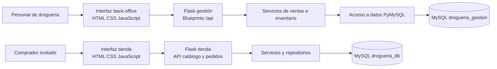

# Arquitectura implementada

## 1. Vista general

El repositorio agrupa dos aplicaciones Flask con despliegue y bases independientes. La aplicación interna es un sistema de gestión/dispensación; la tienda es un prototipo de comercio electrónico. No comparten tablas ni hay una integración de sincronización entre bases en el código inspeccionado.



## 2. Estilo y capas

### Sistema interno

- **Presentación:** plantillas y archivos estáticos en `app/templates` y `app/static`.
- **HTTP:** factoría `create_app`, blueprints de `app/routes`, JSON y páginas HTML.
- **Seguridad transversal:** `app/seguridad.py` implementa sesión, permisos, CSRF y cabeceras.
- **Negocio:** `app/services/ventas.py` e `inventario.py` implementan reglas de ventas, FEFO, entrada de mercancía y ajustes.
- **Datos:** `app/db.py` ofrece conexión por contexto de petición, consultas parametrizadas, paginación y transacciones.
- **Persistencia:** esquema MySQL, vistas, función, triggers, procedimientos y scripts de datos en `database/`.

Es un monolito modular por capas: la interfaz HTTP y los módulos comparten proceso Flask, y las reglas de negocio están separadas del acceso SQL. No es una arquitectura de microservicios.

### Tienda

- **Presentación:** Jinja, CSS, JavaScript y recursos en `tienda/app`.
- **HTTP:** rutas de páginas en `tienda/app/__init__.py`; API en `tienda/app/api/`.
- **Negocio:** `tienda/app/servicios/` valida catálogo y pedidos, calcula precios vigentes, comprueba requisitos de fórmula, asigna FEFO y gestiona inicio de sesión y datos de cuenta.
- **Persistencia:** `tienda/app/repositorios/` contiene SQL; `tienda/app/db.py` administra conexión y transacción.
- **Configuración comercial:** zonas/horarios/contacto en `tienda/datos_tienda.toml`; credenciales por entorno.

## 3. Flujo transaccional

1. El endpoint valida formato de entrada y autorización.
2. El servicio vuelve a consultar precio, estado y existencias en la base; no confía en valores económicos del navegador.
3. La operación abre transacción y bloquea filas relevantes.
4. Inserta encabezado, detalles, movimientos e historial y actualiza lotes.
5. Confirma si todos los pasos terminan; ante excepción hace rollback.

En la gestión interna el servicio de ventas consume lotes vigentes por fecha, bloquea los lotes en orden de medicamento y crea detalle/kárdex. La tienda bloquea inventario por sede y asigna FEFO.

## 4. Seguridad observada

- Back-office: control de acceso por roles en servidor, sesión firmada de Flask, token CSRF en mutaciones, consultas parametrizadas, bloqueo por intentos y hash de contraseña Werkzeug.
- Tienda: límites de cuerpo, comprobación de firma MIME del archivo, restricción de peticiones POST, cabeceras CSP y de protección, sesión firmada para pedidos y cuenta, y eliminación de query strings de logs. El cliente puede iniciar sesión en una cuenta existente; no hay registro público.
- Ambas configuraciones generan una clave temporal si no hay `SECRET_KEY`; para despliegue estable debe configurarse una clave secreta fija y HTTPS/cookie segura.
- La aplicación interna usa una CSP que permite estilos en línea; la tienda restringe scripts/estilos en línea.

## 5. Arquitectura diseñada vs. código existente

`docs/ARQUITECTURA.md` es un documento de diseño de la tienda y contiene nombres de módulos/funcionalidades proyectadas que no coinciden por completo con la implementación actual. La tienda real sí tiene Flask, PyMySQL, catálogo y pedidos, pero usa las rutas `tienda/app/api`, servicios y repositorios. No se hallaron Blueprints implementados para aprobación farmacéutica, administración, ni todos los pasos de checkout que el diseño menciona. `tienda/README.md` es la fuente más fiel al comportamiento de la tienda actual. En gestión, el esquema activo es `database/01_esquema.sql`; `database/schema.sql` corresponde al esquema separado de la tienda.

## 6. Estructura relevante

```text
app/                 Back-office: rutas, servicios, seguridad, DB, estáticos y plantillas
database/            Esquema y datos de drogueria_gestion, rutinas y utilidades de instalación
tienda/app/          Aplicación web de tienda: API, servicios, repositorios, plantillas y estáticos
database/schema.sql Esquema drogueria_db (tienda)
database/seed.sql   Catálogo/datos base de la tienda
docs/                Especificación, arquitectura, datos y pruebas
```

## 7. Instalación y operación

Versiones y comandos están en los READMEs de raíz y tienda. La inicialización de gestión ejecuta `DROP DATABASE` en el esquema objetivo si se fuerza una reinstalación; no ejecutar contra una base con información que se deba conservar. La tienda requiere ejecutar sus scripts separados y arrancar desde `tienda/` con su archivo `.env`.
