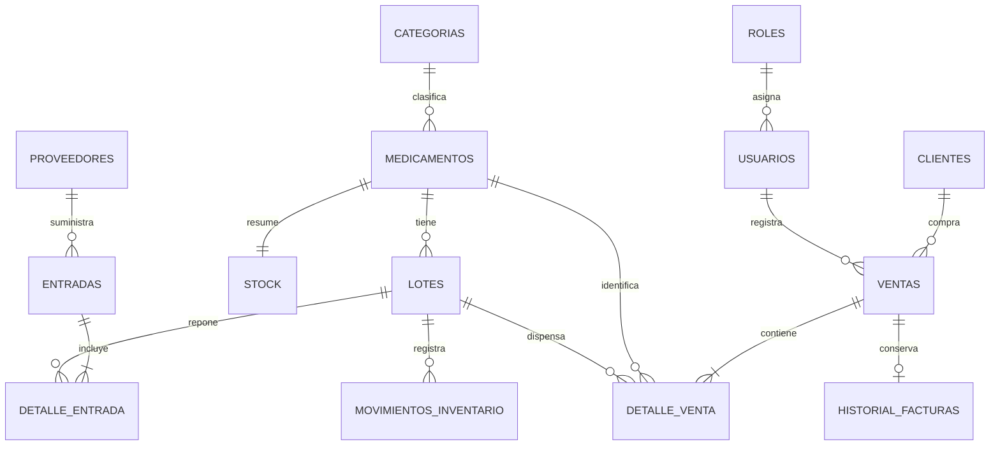

# Diseño de bases de datos

## 1. Separación de dominios

Hay dos esquemas independientes, definidos por scripts distintos. `database/01_esquema.sql` instala `drogueria_gestion`; `database/schema.sql` instala `drogueria_db`. No se debe cargar un esquema sobre el otro. Ambos usan MySQL/InnoDB y `utf8mb4`.

## 2. Modelo de gestión (`drogueria_gestion`)

| Grupo | Tablas | Propósito y relaciones clave |
|---|---|---|
| Acceso | `roles`, `usuarios` | Usuario pertenece a rol; documento, nombre de usuario y email únicos. |
| Catálogo | `categorias`, `medicamentos`, `historial_precios` | Medicamento pertenece a categoría; código único; historial asocia cambios con usuario opcional. |
| Personas/abastecimiento | `clientes`, `proveedores`, `entradas`, `detalle_entrada` | Cliente tiene documento único por tipo, ciudad y país para clasificación; factura única por proveedor; entrada registra sus renglones y lotes. |
| Inventario | `lotes`, `stock`, `movimientos_inventario` | `stock` resume unidades por medicamento y se sincroniza transaccionalmente desde los lotes; cada movimiento conserva saldo y causa. |
| Venta | `consecutivos`, `ventas`, `historial_facturas`, `detalle_venta` | Factura con consecutivo, cliente y vendedor; el historial conserva una cabecera por factura y los detalles indican lote, cantidad, precio, IVA y costo histórico. |
| Control | `auditoria`, `configuracion` | Eventos de usuario y parámetros del sistema. |

Relaciones centrales:

### Restricciones importantes

- PK autoincrementales y FK con políticas explícitas `RESTRICT`, `CASCADE` o `SET NULL`.
- UNIQUE para nombres de rol/categoría, código del medicamento, NIT, usuario/email/documento, número de factura, proveedor-factura y medicamento-lote.
- `CHECK` para valores positivos, precios, IVA, fechas, descuentos y regla de control especial requiere fórmula.
- InnoDB permite transacciones y bloqueos de filas.

### Vistas y rutinas

- `v_stock_medicamentos`: consolida cantidades actuales separando stock vigente y vencido; clasifica `AGOTADO`, `BAJO`, `NORMAL`.
- `v_lotes_vencimiento`: calcula días y estado (`VENCIDO`, `CRITICO`, `PROXIMO`, `VIGENTE`).
- `v_ventas` y `v_ventas_diarias`: consultas de ventas para operación y reportes.
- `stock`: tabla resumida por medicamento, mantenida por triggers en los cambios de lotes y dentro de la misma transacción.
- `historial_facturas`: tabla de cabeceras inmutables, una por factura; los renglones asociados permanecen en `detalle_venta`.
- `fn_stock_disponible(id)`: suma stock vigente.
- `trg_medicamentos_precio_au`: registra cambio de precio.
- `trg_detalle_venta_bi`: bloquea dispensación de lote de otro producto, vencido o sin stock.
- `trg_ventas_bu`: evita modificar venta anulada.
- `sp_dar_baja_lotes_vencidos`: fija en cero cantidades vencidas y registra kárdex en transacción.
- `sp_reporte_ventas`: reporte diario de periodo.

### Diccionario resumido

| Tabla | Campos representativos | Claves de negocio |
|---|---|---|
| `medicamentos` | código, nombre, principio activo, concentración, forma, presentación, INVIMA, fórmula/controlado, precios, IVA, stock mínimo | código único, categoría FK |
| `lotes` | medicamento, proveedor, número, vencimientos, cantidades, costo | único medicamento+número; fechas válidas |
| `stock` | medicamento, cantidad total, fecha de actualización | una fila por medicamento; sincronizada desde `lotes` |
| `ventas` | factura, cliente, usuario, subtotal, descuento, impuesto, total, pago, estado | factura única; totales no negativos |
| `historial_facturas` | venta, número, fecha, cliente, subtotal, descuento, impuesto, total, método de pago | una fila histórica por factura; FK a `ventas` |
| `detalle_venta` | venta, medicamento, lote, cantidad, precio, IVA, impuesto, costo | FK; cantidad positiva |
| `movimientos_inventario` | lote, medicamento, tipo, cantidad, saldo, motivo, usuario, fecha | Kárdex auditable |
| `clientes` | tipo/número documento, contacto, dirección, ciudad, país, consentimiento | documento único por tipo |
| `auditoria` | usuario, acción, módulo, descripción, IP, fecha | actor opcional para conservar registro tras baja |

## 3. Modelo de tienda (`drogueria_db`)

| Grupo | Tablas | Propósito |
|---|---|---|
| Identidad/ubicación | `roles`, `usuarios`, `ciudades`, `direcciones`, `sedes` | Compradores invitados, direcciones, cobertura y puntos de despacho/retiro. |
| Catálogo | `categorias`, `laboratorios`, `principios_activos`, `productos`, `producto_principio_activo` | Productos, taxonomía y relación N:M con principios activos. |
| Stock | `lotes`, `inventario`, `movimientos_inventario` | Lote farmacéutico e inventario por sede; kárdex. |
| Comercio | `promociones`, `promocion_producto`, `carritos`, `carrito_items` | Promociones, asociación de productos y carrito persistente disponible en esquema. |
| Pedido | `formulas_medicas`, `pedidos`, `pedido_items`, `pedido_item_lotes`, `pedido_historial` | Fórmula, cabecera, productos/precios congelados, asignación de lotes e historial. |
| Control | `auditoria` | Registro de eventos. |

La relación clave es `producto → inventario por sede → lote`; el pedido fija cantidades/precio/descuento y vincula los lotes dispensados para trazabilidad. La fórmula puede enlazarse con cada línea que la requiere. Hay `CHECK` para precio/IVA, cantidades, total de pedido, tipo MIME y estados; las FK preservan referencias comerciales.

## 4. Normalización y decisiones

El catálogo separa categorías/laboratorios/principios activos y usa tabla puente para la relación producto-principio activo. El detalle de venta/pedido separa datos variables por renglón de encabezados. El lote conserva la fecha/costo para control sanitario y costo de venta. Se guardan copias históricas de precio de venta, precio unitario de venta y dirección de despacho para reproducir la operación aunque el catálogo o dirección cambien luego. La normalización concreta se estima en 3FN para entidades operativas; no se presenta como prueba formal de dependencias funcionales.

## 5. Instalación y respaldo

- Gestión: `database/init_db.py` ejecuta esquema, rutinas, datos demo y mejoras. El script base hace `DROP DATABASE`; usar `--bd drogueria_gestion_test` para un entorno aislado.
- En una base existente, `python database/init_db.py --solo-mejoras` añade ciudad/país, `stock`, `historial_facturas`, sus triggers y los índices sin recrear la base.
- Para un backup lógico: configure el login path `drogueria-backup` con `mysql_config_editor` y ejecute `powershell -ExecutionPolicy Bypass -File database/backup_mysql.ps1 -Database drogueria_gestion` (repita con `-Database drogueria_db`). El SQL generado se guarda en `docs/entrega/backup/` y se excluye de Git.
- Tienda: ejecutar `database/schema.sql` y `database/seed.sql` por separado, siguiendo `tienda/README.md`.
- No se encontró un proceso automatizado de backup/restauración ni migraciones versionadas incrementales; `04_mejoras.sql` es un conjunto de mejoras de gestión.
- El contenido de seed es de demostración. Verificar y reemplazarlo antes de cualquier uso real.
